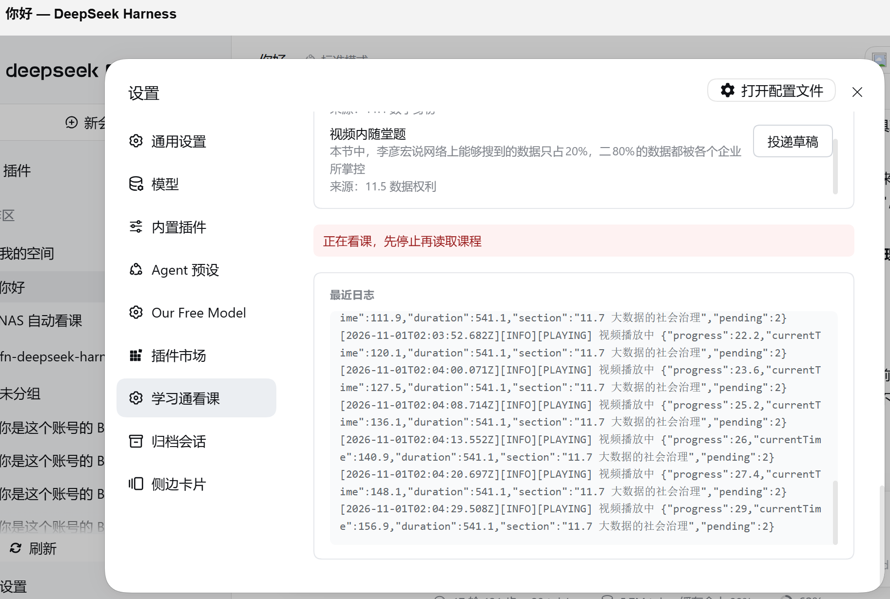

# cx-learn

> 把「超星学习通看课」变成一个**可调度、可观测、可随时停止**的 DSH 插件。

用 CDP（Chrome DevTools Protocol）驱动一个真实的 Chromium，自动推进课程视频：
恢复播放、关掉防挂机弹窗、自然结束自动切下一节、跳过已完成的小节。

**它不答题、不写后端、不伪造进度**：

- 视频内的**随堂题**按选项顺序盲试（不计入课程成绩），答错换下一个；
- **章节测验 / 作业**只识别、只记录，连标签都不点；
- 一旦页面出现**人脸识别 / 活体 / 验证码**，立即停止，不做任何绕过。

---

## 功能

| 能力 | 说明 |
|---|---|
| P0 播放态检测 | 视频被暂停就恢复播放；自动关掉防挂机弹窗 |
| P1 自动切节 | 本节播完自动切下一节；切节后校验播放器确实换了内容 |
| P2 随堂题盲试 | 只点 `.ans-videoquiz` 里的选项；遇到「回看」惩罚或次数耗尽立即停 |
| P3 跳过已完成 | 按任务点级证据判断，已看完的小节直接跳过 |
| P4 章节模式 | 单章节 / 章节连播，可限制每轮新增看完的节数 |
| 扫码登录 | 设置页直接显示二维码，手机学习通扫一次 |
| 会话复用 | 一段连续使用期内，内核与登录态不销毁，可连刷多门课 |
| 人工审阅队列 | 识别到的题目进队列（不含答案），可一键生成对话框草稿 |

## 安全边界（不可协商）

1. **章节测验 / 作业绝不触碰** —— 不点选项、不提交、连标签都不点。
2. **随堂题盲试是唯一的自动作答例外**（不计成绩）。
3. 人脸 / 活体 / 验证码 → 立即停止，不绕过。
4. 不调用学习通任何进度写接口、不伪造上报。
5. 识别不出来**不停机**（题目分类不确定时记录并继续）；只有确定性死循环才停。

## 环境要求

- DSH（DeepSeek Harness）`>= 0.2.0-rc.1`
- Node.js `>= 22`
- 一个 Chromium 系浏览器内核（Chrome / Edge / Chromium / chrome-headless-shell）

插件本身**零 npm 依赖**，引擎只用 Node 内置模块。

## 运行实例



*设置页两块：浏览器环境（内核、会话）与课程业务（登录、课程、启停）；题目进「待处理题目」队列，超过 3 条自动折叠；下面是实时日志。*

## 安装

**方式一：插件市场**

在 DSH 的插件管理页搜索 `cx-learn`，安装后启用。

**方式二：本地链接（开发）**

```bash
git clone https://github.com/forgotfish/dsh-cx-learn.git
cd cx-learn
dsh plugin --profile web add link:$PWD
```

重启对应的 DSH 实例生效。

## 快速上手

1. 准备浏览器内核（见下节），或用系统自带的 Chrome / Edge。
2. 打开 DSH → **设置 → 学习通看课**。
3. 点「开始登录」→ 约 10 秒后点「刷新二维码」→ 用手机学习通扫码确认。
4. 点「读取我的课程」→ 选一门课（会自动带上 `clazzid` / `enc`）。
5. 点「保存配置」→「开始看课」。

运行状态、内核健康、最近日志都在同一页；题目进「待处理题目」，超过 3 条自动折叠。

## 浏览器内核

按以下顺序探测：

1. 设置页里填的**自定义路径**
2. 共享内核目录（`CX_BROWSER_ROOT` 或 `$DSH_HOME/cx-learn/browsers`）
3. 系统已安装的 Chrome / Edge

内核目录结构：

```
browsers/
├── chrome-linux64/
│   └── chrome
└── chrome-headless-shell-linux64/
    └── chrome-headless-shell
```

> 部分精简版 Chromium 缺 H.264/AAC 解码，播放某些课程会失败；完整 `chrome` 更稳。

## 配置（`$DSH_HOME/cx-learn/config.json`）

| 字段 | 默认 | 说明 |
|---|---|---|
| `courseUrl` | `''` | 课程学习页地址 |
| `mode` | `continue_chapters` | `continue_chapters` 连播 / `current_chapter` 只跑当前章 |
| `maxSections` | `5` | 单轮最多**新看完**多少节；跳过已看的不计数 |
| `videoDoneAt` | `98.5%` | 播放进度到多少算「看够」，之后等平台确认 |
| `browserId` | `''` | 选中的内核 id（空 = 自动探测） |
| `chromiumPath` | `''` | 自定义内核绝对路径（优先） |
| `headless` | `true` | 是否无头运行 |
| `quizMode` | `skip` | 只影响章节测验（跳过）；随堂题始终盲试 |

安全相关（`safety`）：`videoNotConfirmedMax`（连续「播完未确认」上限，默认 3）、
`quizIgnoreMax`（连续忽略题目上限，默认 12）、`skipChapterQuiz`（默认 true）。

## HTTP 接口

挂在 `/api/cx-learn` 前缀下，共 20 个 handler：

| 方法 | 路径 | 说明 |
|---|---|---|
| GET | `/health` | 轻量快照（毫秒级，不调模型/不读日志） |
| GET | `/status` | 完整状态（配置、内核、会话、题目队列、日志尾） |
| GET/POST | `/config` | 读 / 部分写配置 |
| POST | `/ask` | **预留**的 AI 答题接口，当前固定返回 `AI_ANSWER_DISABLED` |
| POST | `/start`、`/check-login`、`/start-precheck` | 启动 / 预检 / 预检后启动 |
| POST | `/stop` | 停止当前任务（保留会话） |
| POST | `/session/end` | 结束会话：关内核 + 销毁登录态 |
| POST | `/browser/restart` | 只清本插件自己的内核进程 |
| POST | `/login`、`/qr`、`/qr/refresh`、`/login-state` | 扫码登录相关 |
| GET | `/courses` | 课程列表 |
| GET | `/questions`、`POST /questions/:id/draft` | 题目队列 / 生成草稿 |
| GET | `/browsers`、`/log` | 内核清单 / 最近日志 |

## 架构

```
client.js              设置页 UI（React，DSH 客户端插件）
index.js               宿主半端：进程生命周期、HTTP 接口、配置、会话
engine/
  chaoxing-autolearn.js  入口薄壳（CLI 分发）
  src/core/              依赖、配置、日志、题目事件
  src/browser/           启动参数、CDP 适配器、退出守卫
  src/learn/             选择器表、判定纯函数、状态机、主循环
  src/login/             扫码登录 / 临时 profile
```

- 选择器集中在 `engine/src/learn/selectors.js` 的 `SELECTORS` 表；
- 完成判定是纯函数（`judge.js`），有表驱动测试；
- 浏览器层与业务层通过 `engine/.state/*.json` 中间文件解耦。

## 开发与测试

```bash
node --check index.js
node --check client.js
node engine/chaoxing-autolearn.js --self-test

# 纯函数 / 策略 / 契约测试（不启动浏览器）
node engine/judge.test.cjs
node engine/section-skip.test.cjs
node engine/guardrails.test.cjs
node engine/session.test.cjs
node scripts/host-smoke.test.cjs      # 导入真实 index.js 跑路由
node scripts/ui-render.test.cjs       # 无浏览器渲染设置页
node scripts/check-selectors.cjs      # 选择器只许出现在表里
node scripts/verify-injectable.cjs    # 注入脚本能编译
```

真机/模拟站端到端（需要本地浏览器）：

```bash
node scripts/mock-course/run.cjs
node scripts/mock-course/run-scenarios.cjs
```

## 已知限制

- **人脸识别会中断**：平台常按学习进度随机抽 3–5 次人脸核验，插件检测到就停，需要本人在手机端完成核验后继续。
- 平台判定的是**观看时长**，不是播放位置；断点续播时可能因「本轮观看时长不足」而不记账。
- 某些小节的目录项可能点不进去（页面折叠/入口不同），插件会校验 knowledgeid，对不上则停止并给出原因，不会拿上一节冒充。
- 无头浏览器可能被平台判为异常环境，行为因账号/课程而异。

## 免责声明

本项目用于**浏览器自动化技术研究**。超星学习通等平台普遍禁止自动化脚本，
使用可能导致学习进度被退回或账号处罚。使用者需自行确认所在平台的服务条款与当地法规，
并自行承担全部责任。

## License

MIT
